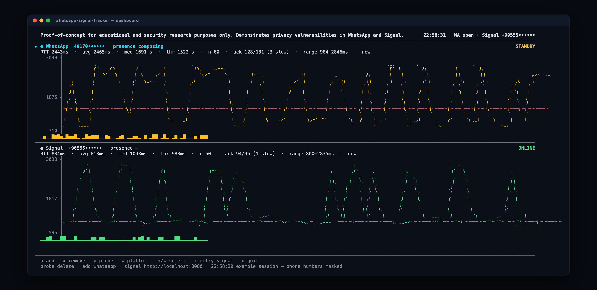
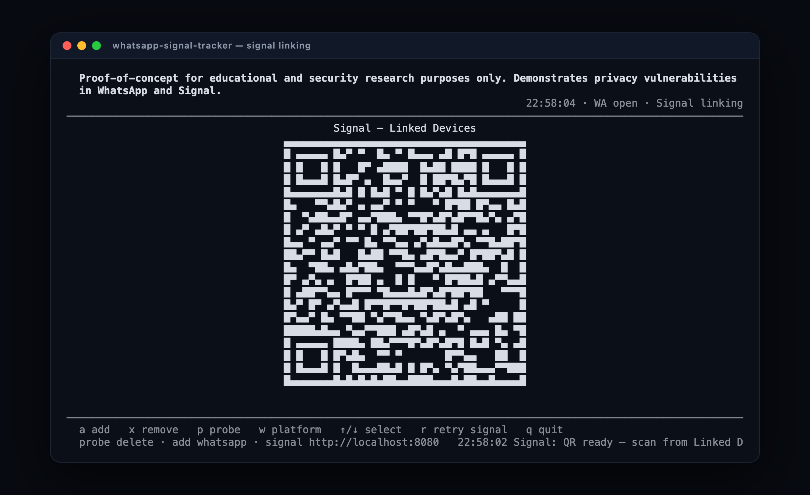

<h1 align="center">WhatsApp &amp; Signal Tracker</h1>
<p align="center">RTT-based messaging activity analysis in the terminal</p>

> **Proof-of-concept for educational and security research purposes only. Demonstrates privacy vulnerabilities in WhatsApp and Signal.**



*Example session; phone numbers are masked in the screenshots.*

A terminal client that links WhatsApp and Signal accounts, sends silent protocol-level probes, measures the round-trip time (RTT) of delivery receipts and plots how it changes per contact. No web server, no database: one Node.js process, plus signal-cli-rest-api when Signal tracking is needed.

## Features

- WhatsApp account linking with the QR code rendered directly in the terminal (Baileys)
- Signal linking through signal-cli-rest-api, including PNG QR decoding and re-rendering as a terminal QR
- Multi-contact tracking with per-contact braille RTT charts, threshold line and sparkline
- Probe methods: silent delete (default) and reaction
- WhatsApp presence display and live state estimation
- Full-screen TUI with keyboard control
- Standalone package with its own dependencies; WhatsApp session state stays in a gitignored folder

## Requirements

- Node.js 20+
- A terminal with Unicode support (block and braille characters)
- Optional for Signal: a running `signal-cli-rest-api` instance

## Install and run

```bash
npm install
npm start
```

Link WhatsApp by scanning the QR code from **Linked Devices**. For Signal, start the bridge first:

```bash
docker run -d --name signal-api --restart unless-stopped \
  -p 8080:8080 -e MODE=json-rpc bbernhard/signal-cli-rest-api
```

If no Signal account is linked, the CLI shows a pairing QR. Afterwards:

- `w` switches the add platform to Signal
- `a` adds a phone number (E.164 format)

## Keys

| Key | Action |
|-----|--------|
| `a` | Add a contact for the current platform |
| `x` | Stop tracking the selected contact |
| `p` | Toggle the WhatsApp probe method (delete/reaction) |
| `w` | Switch the add platform (WhatsApp/Signal) |
| `↑` / `↓` | Select a contact |
| `r` | Retry the Signal connection/link |
| `q` | Quit |

## Options

| Option | Description |
|--------|-------------|
| `--auth-dir=DIR` | WhatsApp auth folder (default `auth_info_baileys`) |
| `--signal-api=URL` | signal-cli-rest-api base URL (default `http://localhost:8080`) |
| `--probe=MODE` | WhatsApp probe: `delete` or `reaction` (default `delete`) |
| `-h`, `--help` | Show usage |

## How it works

1. A probe is sent as a protocol message that references a non-existent message id (`delete` or `reaction`); no chat content is added.
2. The recipient device still emits a delivery receipt (CLIENT ACK). The client correlates receipts by probe message id and computes RTT.
3. Per contact, the analyzer keeps a history (capped at 2000 samples), computes the median and sets `threshold = median × 0.9`. If the moving average of the last three samples is below the threshold the state is `Online`, otherwise `Standby`. No ACK within the timeout is `OFFLINE`.

`Standby` is therefore a threshold rule, not a ground-truth device state. A tight single-cluster RTT distribution makes the rule default to `Standby`; it becomes meaningful when online and standby produce two separated RTT clusters. Replies slower than 5 s are excluded from the RTT history and counted as `(+N slow)`. Watch the slow count and the observed `range` in the metrics line for a more honest signal.

## Signal pairing example



The QR payload in this screenshot is fictional.

## Session data and privacy

- WhatsApp credentials are written to `auth_info_baileys/` (or `--auth-dir`). The folder is gitignored; never commit or share it.
- Signal account state is kept by signal-cli-rest-api. Mount its data directory if the container is recreated.
- A Signal account streams receipts to one websocket consumer; do not run two tracking clients against the same account.
- No telemetry and no external logging.

## Project layout

```
.
├── src/
│   ├── index.ts      # TUI entry point
│   ├── app.ts        # controller, probe loops, keybindings
│   ├── ui.ts         # dashboard renderer (charts + QR)
│   ├── chart.ts      # braille RTT chart and sparkline
│   ├── qr.ts         # terminal QR + PNG QR decoding
│   ├── rtt.ts        # RTT history and thresholds
│   ├── whatsapp.ts   # Baileys probe engine
│   ├── signal.ts     # signal-cli-rest-api client
│   └── types.ts      # shared types
├── scripts/
│   └── check-deps.mjs
├── docs/
│   ├── dashboard.png
│   └── linking.png
├── package.json
└── tsconfig.json
```

Typecheck with `npm run typecheck`, build with `npm run build` and run the compiled output with `node dist/index.js`.

## Ethical and legal notice

Only use this against accounts and devices you own or have explicit permission to test. Tracking people without consent can violate privacy and computer-misuse laws. This project exists to demonstrate and study the underlying vulnerability.

## Research credit

This implementation follows the research presented in “Careless Whisper: Exploiting Silent Delivery Receipts to Monitor Users on Mobile Instant Messengers” by Gabriel K. Gegenhuber, Maximilian Günther, Markus Maier, Aljosha Judmayer, Florian Holzbauer, Philipp É. Frenzel and Johanna Ullrich (University of Vienna & SBA Research).

## License

MIT — see [LICENSE](LICENSE). Not affiliated with, endorsed by, or sponsored by WhatsApp or Signal; all trademarks belong to their respective owners.
